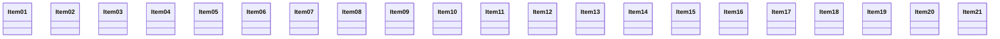

# Map: 21 nodes (warning only)

## Current state

| Element | Evidence | Note |
|---|---|---|
| Item01 | src/Many.cs:3 | item |
| Item02 | src/Many.cs:4 | item |
| Item03 | src/Many.cs:5 | item |
| Item04 | src/Many.cs:6 | item |
| Item05 | src/Many.cs:7 | item |
| Item06 | src/Many.cs:8 | item |
| Item07 | src/Many.cs:9 | item |
| Item08 | src/Many.cs:10 | item |
| Item09 | src/Many.cs:11 | item |
| Item10 | src/Many.cs:12 | item |
| Item11 | src/Many.cs:13 | item |
| Item12 | src/Many.cs:14 | item |
| Item13 | src/Many.cs:15 | item |
| Item14 | src/Many.cs:16 | item |
| Item15 | src/Many.cs:17 | item |
| Item16 | src/Many.cs:18 | item |
| Item17 | src/Many.cs:19 | item |
| Item18 | src/Many.cs:20 | item |
| Item19 | src/Many.cs:21 | item |
| Item20 | src/Many.cs:22 | item |
| Item21 | src/Many.cs:23 | item |
