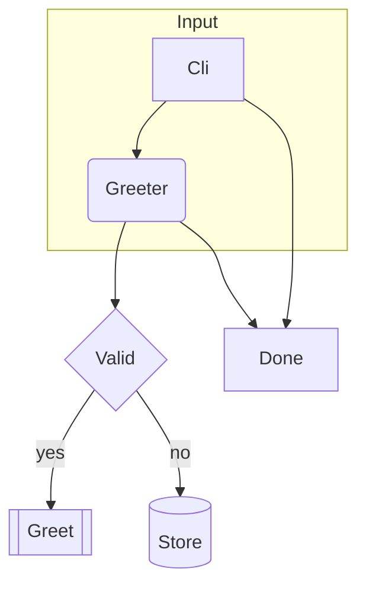
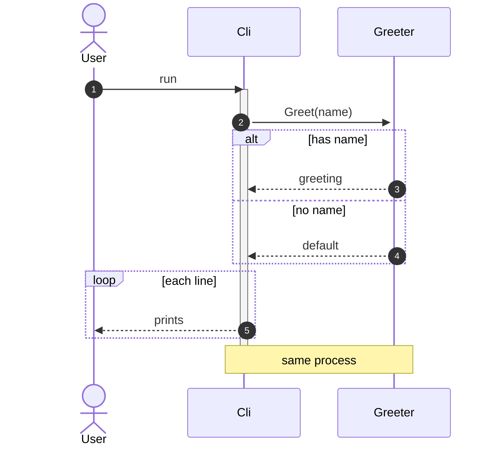

# Map: realistic syntax coverage

## Current state

```mermaid
classDiagram
    class Foo {
        +Bar() int
    }
    class Box~T~
    class Cache<T>
    Foo "1" --> "*" Box~T~ : holds
    Box~T~ <|-- Cache<T> : extends
```

| Element | Evidence | Note |
|---|---|---|
| Foo | src/Model.cs:3 | class |
| Box | src/Model.cs:8 | generic |
| Cache | src/Model.cs:10 | generic |
| Foo --> Box | src/Model.cs:3-8 | holds |
| Box <\|-- Cache | src/Model.cs:8-10 | extends |



| Element | Evidence | Note |
|---|---|---|
| A | src/Cli.ps1:3 | entry point |
| B | src/Greeter.cs:3 | class |
| C | src/Pipeline.cs:5 | predicate |
| D | src/Greeter.cs:5 | method |
| E | src/Pipeline.cs:6 | store |
| F | new (T19) | added |
| Cli --> Greeter | src/Cli.ps1:4-5 | calls |
| Greeter --> Valid | src/Pipeline.cs:5 | checks |
| Valid --> Greet | src/Greeter.cs:5 | delegates |
| Valid --> Store | src/Pipeline.cs:6 | persists |
| Cli --> Done | new (T19) | new |
| Greeter --> Done | new (T19) | new |



| Element | Evidence | Note |
|---|---|---|
| U | src/Cli.ps1:3 | the caller |
| A | src/Cli.ps1:3 | entry |
| B | src/Greeter.cs:3 | greeter |
