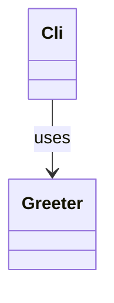
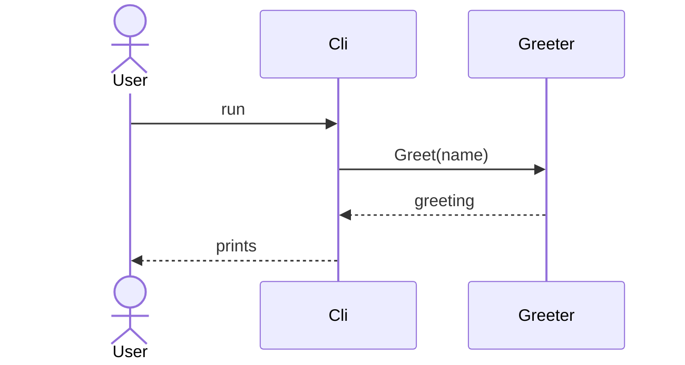
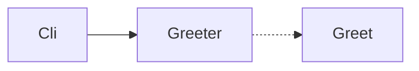
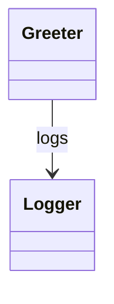

# Map: greeting CLI

## Current state

| Element | Evidence | Note |
|---|---|---|
| Greeter | src/Greeter.cs:3 | class declaration |
| Cli | src/Cli.ps1:3 | entry point |
| Cli --> Greeter | src/Cli.ps1:4-5 | constructs and calls |

| Element | Evidence | Note |
|---|---|---|
| User | src/Cli.ps1:3 | the caller |
| Cli | src/Cli.ps1:3 | participant |
| G | src/Greeter.cs:3 | alias of Greeter |

| Element | Evidence | Note |
|---|---|---|
| A | src/Cli.ps1:3 | entry point |
| Greeter | src/Greeter.cs:3 | matched by label |
| C | src/Greeter.cs:5 | method |
| A --> Greeter | src/Cli.ps1:4-5 | calls |
| Greeter -.-> Greet | src/Greeter.cs:5 | calls the method |

## Target state

| Element | Evidence | Note |
|---|---|---|
| Greeter | src/Greeter.cs:3 | unchanged |
| Logger | new (T19) | added by T19 |
| Greeter --> Logger | new (T19) | logs greetings |
